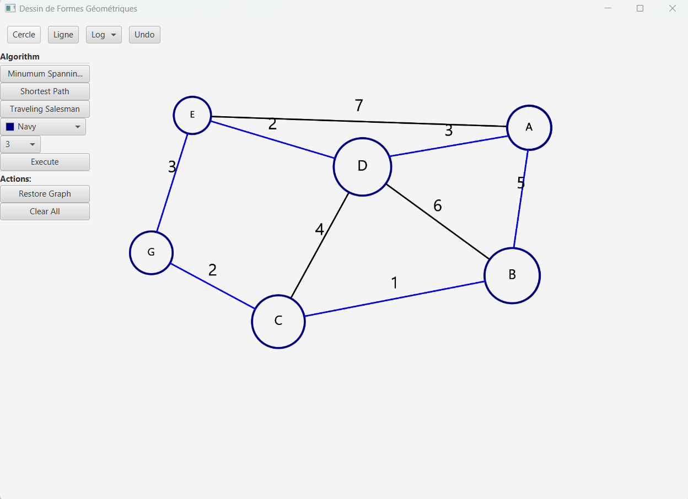
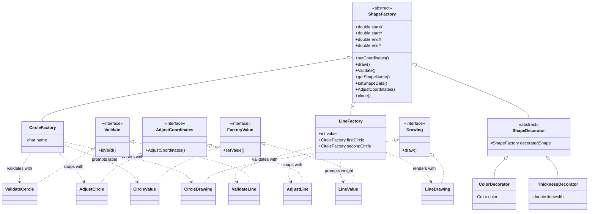
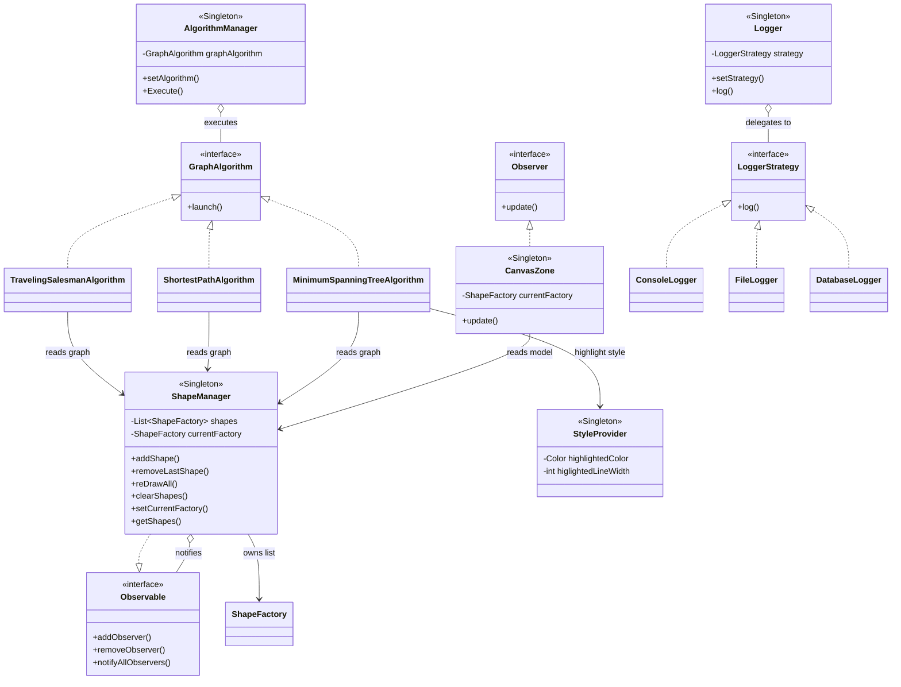
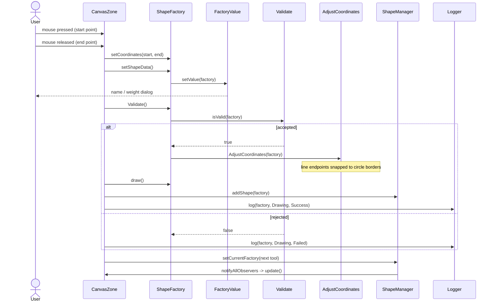

# SketchGraph

**Sketch a weighted graph on a canvas, then solve it visually — Minimum Spanning Tree, Shortest Path and Traveling Salesman.**

JavaFX desktop application built as the *Modélisation* coursework project (final-year engineering, IIT Sfax). The whole point of the project is the modelling itself: one shape abstraction that serves both drawing and graph solving, extended through design patterns instead of `if/else` branches.



*Kruskal's algorithm on a hand-drawn graph. The navy edges are the 5 selected tree edges (total weight **11**); the black edges were rejected because they would close a cycle. Highlight colour and stroke width come from the sidebar controls.*

---

## Table of contents

1. [What it does](#what-it-does)
2. [Getting started](#getting-started)
3. [How to use it](#how-to-use-it)
4. [Algorithms](#algorithms)
5. [Modélisation and design patterns](#modélisation-and-design-patterns)
6. [Data model and validation rules](#data-model-and-validation-rules)
7. [Logging](#logging)
8. [Project structure](#project-structure)
9. [Known limitations](#known-limitations)
10. [License](#license)

---

## What it does

| | |
|---|---|
| **Draw nodes** | Drag on the canvas to create a circle, then name it (`A`, `B`, …). |
| **Draw edges** | Drag from one circle to another to create a weighted edge and type its value. |
| **Solve** | Pick an algorithm, press `Execute`, and the answer is painted directly on the drawing. |
| **Inspect** | A dialog reports the path/tour/edge list and the total cost. |
| **Undo** | `Undo` removes the most recently drawn shape and repaints the scene. |
| **Audit** | Every drawing and undo action is logged to console, file, or PostgreSQL. |

No file format and no server: the graph lives in memory and is rebuilt from the shape list.

## Getting started

### Prerequisites

- **JDK 21 or newer** — `ShapeManager` uses `List.getLast()`, part of the `SequencedCollection` API added in Java 21.
- **JavaFX SDK 24.0** — the module links `javafx-sdk-24.0` (see `Modelisation.iml`).
- **IntelliJ IDEA** (any edition) — the project ships an `.iml` module and no Maven/Gradle build.
- **PostgreSQL** — only if you select the `DatabaseLog` sink.

The IntelliJ module also carries a MySQL connector that no class ever uses; the only live JDBC driver is the PostgreSQL one.

### Run

1. Open this folder in IntelliJ IDEA (`File > Open`).
2. In `Project Structure > Libraries`, add the unzipped **JavaFX SDK** as a module dependency.
3. Set the run configuration to `Main` and add the VM options if JavaFX is not on the module path:

   ```
   --module-path <path-to>/javafx-sdk-24.0/lib --add-modules javafx.controls
   ```

4. Run `Main.main()`. A window titled *Dessin de Formes Géométriques* opens with a toolbar, a sidebar, and an 800×600 canvas.

> There is no build tool yet, so `javac`/`java` from a terminal needs the same `--module-path` flags. A `pom.xml` or Gradle setup is a good first contribution.

### Optional: enable the PostgreSQL log sink

`DatabaseConnection` never stores a credential. It reads the standard libpq environment variables and creates the `logs` table on first use:

| Variable | Default | Purpose |
|---|---|---|
| `PGHOST` | `localhost` | database host |
| `PGPORT` | `5432` | database port |
| `PGDATABASE` | `logs` | database name |
| `PGUSER` | `postgres` | database user |
| `PGPASSWORD` | *none* | **required** — without it the sink stays disabled |

```bash
# Linux / macOS
export PGUSER=your-db-user PGPASSWORD=your-password-here
```

```powershell
# Windows PowerShell, for the IntelliJ run session only
$env:PGUSER = "your-db-user"; $env:PGPASSWORD = "your-password-here"
```

If `PGPASSWORD` is missing, the app prints `DatabaseLog disabled: set the PGPASSWORD environment variable` once and keeps running — `ConsoleLog` and `FileLog` are unaffected. Expected schema:

```sql
CREATE TABLE IF NOT EXISTS logs (
  id SERIAL PRIMARY KEY,
  timestamp VARCHAR(50),
  startX DOUBLE PRECISION, startY DOUBLE PRECISION,
  endX DOUBLE PRECISION,   endY DOUBLE PRECISION,
  shapeType VARCHAR(50), actionType VARCHAR(50), status VARCHAR(50)
);
```

## How to use it

1. **`Cercle`** — select the circle tool, drag anywhere on the canvas, type a single-character name. Circles with a duplicate name or a radius under 10 px are rejected.
2. **`Ligne`** — select the line tool, drag from a circle to a different circle, type an integer weight. The endpoints snap onto the two circle borders, so the edge always touches the node outline instead of its centre.
3. **Algorithm** — pick `Minumum Spanning Tree`, `Shortest Path` or `Traveling Salesman` in the sidebar.
4. **Style** — choose the highlight `ColorPicker` and stroke width before executing.
5. **`Execute`** — the app redraws the whole scene, paints the solution with the chosen style, and opens a dialog with the result.
6. **`Restore Graph`** repaints the plain graph (drops the highlight); **`Clear All`** empties the model; **`Undo`** removes the last shape drawn.
7. **`Log`** (toolbar menu) switches the audit sink between `ConsoleLog`, `FileLog` and `DatabaseLog`.

## Algorithms

All three implement the same `GraphAlgorithm` contract and read the graph straight out of the shape list, so the drawing *is* the input.

| Algorithm | Class | Approach | Minimum nodes | Result shown |
|---|---|---|---|---|
| Minimum Spanning Tree | `MinimumSpanningTreeAlgorithm` | **Kruskal** with a `DisjointSet` (path compression) over edges sorted by weight — `O(E log E)` | 2 | Tree edges + total weight |
| Shortest Path | `ShortestPathAlgorithm` | **Dijkstra** with a `PriorityQueue` keyed on the distance map | 2 | Node sequence + total weight |
| Traveling Salesman | `TravelingSalesmanAlgorithm` | **Nearest-neighbour heuristic** (approximation, not exact) — `O(V²)` | 3 | Closed tour + total distance |

Details worth knowing:

- **MST** rejects a disconnected graph explicitly (`size != V - 1` → error dialog) instead of silently returning a forest.
- **Dijkstra** builds an adjacency list of `CircleFactory → List<LineFactory>`; edges are treated as undirected. The queue is re-inserted with `queue.remove(neighbor)`, which is linear on a `PriorityQueue`, so this is a teaching implementation rather than a tuned one.
- **TSP** completes the graph: when no drawn edge links two nodes, it falls back to the Euclidean distance between their centres and draws the hop as a **dashed line**, so you can see which legs were invented rather than drawn.

## Modélisation and design patterns

The project is organised as four cooperating layers. Nothing in the canvas layer knows that a graph exists, and nothing in the algorithm layer knows how to stroke a line.

```
Zone (JavaFX UI)  ──►  States (model + observer)  ──►  ShapeFactory (shape lifecycle)
        │                        │                              │
        └──► Algorithm ──────────┴──► Decorators ───────────────┘
                   │                              │
                   └──────────► Logger ◄──────────┘
```

### Patterns at a glance

| Pattern | Where it lives | What it buys |
|---|---|---|
| **Abstract Factory / Factory Method** | `ShapeFactory` (abstract) + `CircleFactory`, `LineFactory`, chosen at runtime by `ShapeManager.setCurrentFactory()` | The `Cercle`/`Ligne` buttons only swap a factory instance; `CanvasZone` never branches on the concrete type except when re-arming the tool. |
| **Strategy** | Four per-shape interfaces — `Validate`, `AdjustCoordinates`, `FactoryValue`, `Drawing` — each with a circle and a line implementation | Each step of the shape lifecycle is a swappable object, so adding a `RectangleFactory` means writing strategies, not editing existing classes. |
| **Decorator** | `ShapeDecorator` → `ColorDecorator`, `ThicknessDecorator` | Algorithm results are highlighted by wrapping an existing shape (`ColorDecorator` inside `ThicknessDecorator`) and calling `draw()`; the shape classes stay untouched and the original `GraphicsContext` state is restored after painting. |
| **Observer / Publish-Subscribe** | `Observable` + `Observer`, implemented by `ShapeManager` → `CanvasZone` | Selecting a tool notifies the canvas instead of the canvas polling the toolbar. |
| **Singleton** | `ShapeManager`, `CanvasZone`, `Logger`, `StyleProvider`, `GraphicsContextProvider`, `DatabaseConnection`, `AlgorithmManager` | One model, one canvas, one graphics context, one log sink — accessed globally without threading references through every constructor. |
| **Command (policy)** | `GraphAlgorithm` interface + `AlgorithmManager.setAlgorithm()` / `Execute()` | The single `Execute` button runs whichever algorithm is selected; algorithms are interchangeable and stateless. |
| **Prototype** | `ShapeFactory implements Cloneable`, overridden `clone()` in both concrete factories | Declared and correct (deep copy of the two endpoint circles), **but not yet wired into any UI action** — see [known limitations](#known-limitations). |

### Class diagram — shape model and its strategies



### Class diagram — model, algorithms, logging



### Sequence — drawing one shape

This is the lifecycle every shape goes through, and where the strategies plug in:



### Package responsibilities

| Package | Responsibility |
|---|---|
| `Zone` | JavaFX nodes only: `CanvasZone` (canvas + mouse), `ToolbarZone` (tools + log menu), `SidebarZone` (algorithms + style + actions). |
| `States` | The single source of truth: an ordered list of shapes plus the observer plumbing. |
| `ShapeFactory` | Shape creation and the full per-shape lifecycle, split into `Validation`, `AdjustCoordinates`, `AdditionalFactoryData` (input dialogs) and `Drawing` (rendering). |
| `Decorators` | Style wrappers used to highlight results. |
| `Algorithm` | `GraphAlgorithm` implementations, the `AlgorithmManager` selector, and `DialogUtils` for JavaFX dialogs. |
| `Providers` | Global access to the `GraphicsContext` and to the highlight style. |
| `Logger` | The audit sink: a `Logger` facade over a pluggable `LoggerStrategy`. |

## Data model and validation rules

The graph is inferred from the shape list, never stored separately:

- a **`CircleFactory`** is a vertex; its centre is the midpoint of the drag, its radius is half the drag length, and its `name` is the node label.
- a **`LineFactory`** is an undirected weighted edge; `value` is the weight, and `firstCircle`/`secondCircle` are the resolved endpoints.

Rules enforced by the `Validate` strategies before a shape is accepted:

| Rule | Enforced by |
|---|---|
| No zero-size drag (start equals end) | `ValidateCercle`, `ValidateLine` |
| Circle radius must be at least 10 px | `ValidateCercle` |
| Circle names must be unique | `ValidateCercle` |
| Line weight must be a valid integer (re-prompts otherwise) | `LineValue` |
| A line must attach to **two different** circles | `ValidateLine` |
| Endpoint resolution = nearest circle centre to each end of the drag | `ValidateLine` |
| Accepted lines are re-trimmed to the circle outlines | `AdjustLine` |

Rejected shapes are still logged with `Status: Failed`, so the audit trail records mistakes as well as successes.

## Logging

`Logger` is a Singleton facade; the sink is a Strategy chosen from the toolbar `Log` menu and defaults to `ConsoleLogger`. Every entry carries a timestamp, the shape type, its start/end coordinates, the action and its status.

| Sink | Output |
|---|---|
| `ConsoleLogger` | `System.out` |
| `FileLogger` | `log_file.txt` next to the working directory, append mode |
| `DatabaseLogger` | `INSERT INTO logs (...)` through a shared `DatabaseConnection` Singleton |

Example line produced by an undo action:

```
[2025-06-11 13:30:57] [ Start: (197.12, 101.59), End: (419.43, 183.23)] [Undo Line] [Status: Success]
```

Note: `Logger.strategy` is a `static` field, so the sink is shared process-wide and switching it is not thread-safe.

## Project structure

```
src/
├── Main.java                       JavaFX entry point, wires zones together
├── Algorithm/
│   ├── GraphAlgorithm.java         algorithm contract
│   ├── AlgorithmManager.java       Singleton selector + Execute
│   ├── MinimumSpanningTreeAlgorithm.java   Kruskal + DisjointSet
│   ├── ShortestPathAlgorithm.java          Dijkstra
│   ├── TravelingSalesmanAlgorithm.java     nearest neighbour
│   └── DialogUtils.java            alert / selection dialogs
├── States/
│   ├── ShapeManager.java           shape list + Observable
│   ├── Observable.java
│   └── Observer.java
├── ShapeFactory/
│   ├── ShapeFactory.java           abstract shape + Prototype
│   ├── CircleFactory.java
│   ├── LineFactory.java
│   ├── Validation/                 Validate, ValidateCercle, ValidateLine
│   ├── AdjustCoordinates/          AdjustCoordinates, AdjustCircle, AdjustLine
│   ├── AdditionalFactoryData/      FactoryValue, CircleValue, LineValue
│   └── Drawing/                    Drawing, CircleDrawing, LineDrawing
├── Decorators/
│   ├── ShapeDecorator.java
│   ├── ColorDecorator.java
│   └── ThicknessDecorator.java
├── Zone/
│   ├── CanvasZone.java             canvas + mouse handlers, Observer
│   ├── ToolbarZone.java            Cercle / Ligne / Log / Undo
│   └── SidebarZone.java            algorithms, style, actions
├── Providers/
│   ├── GraphicsContextProvider.java
│   └── StyleProvider.java
└── Logger/
    ├── Logger.java                 facade
    ├── LoggerStrategy.java
    ├── ConsoleLogger.java
    ├── FileLogger.java
    ├── DatabaseLogger.java
    └── DatabaseConnection.java
```

## Known limitations

Honest list, mostly because this was coursework under a deadline:

- **No build tool.** IntelliJ-only setup; JavaFX must be attached manually. No tests.
- **Prototype is unused.** `clone()` is implemented but no feature calls it, so `Restore Graph` repaints the live objects rather than snapshots.
- **No persistence.** Closing the window loses the graph; there is no save/load format.
- **Hardcoded geometry.** `ShapeManager.removeLastShape()` clears a fixed `900×700` rectangle regardless of the real canvas size, and the default canvas is 800×600 inside a 1000×700 scene.
- **TSP is a heuristic.** Nearest neighbour gives a valid tour, not an optimal one — the dialog does not say so.
- **Dijkstra queue handling** relies on `PriorityQueue.remove()`, which is `O(V)`.
- **Single-threaded UI assumptions** — `ShapeManager.getShapes()` returns a defensive copy, but `Logger`'s static strategy and `GraphicsContextProvider`'s static context are global mutable state.
- **Mixed-language naming** — `ValidateCercle`, `Cercle`, `Dessin de Formes Géométriques` alongside English APIs, and `higlightedLineWidth` is misspelled in `StyleProvider`.
- **Sidebar labels are truncated** (`Minumum Spannin…`) because buttons are fixed at 130 px, and `Minumum` is misspelled in `SidebarZone`.

## License

No license file has been added yet. If you want to reuse or distribute this code, add a `LICENSE` first — the project was written as university coursework, so check what applies before opening it up.

---

*Built with JavaFX 24 and design patterns. Original project folder: `Modelisation`.*
